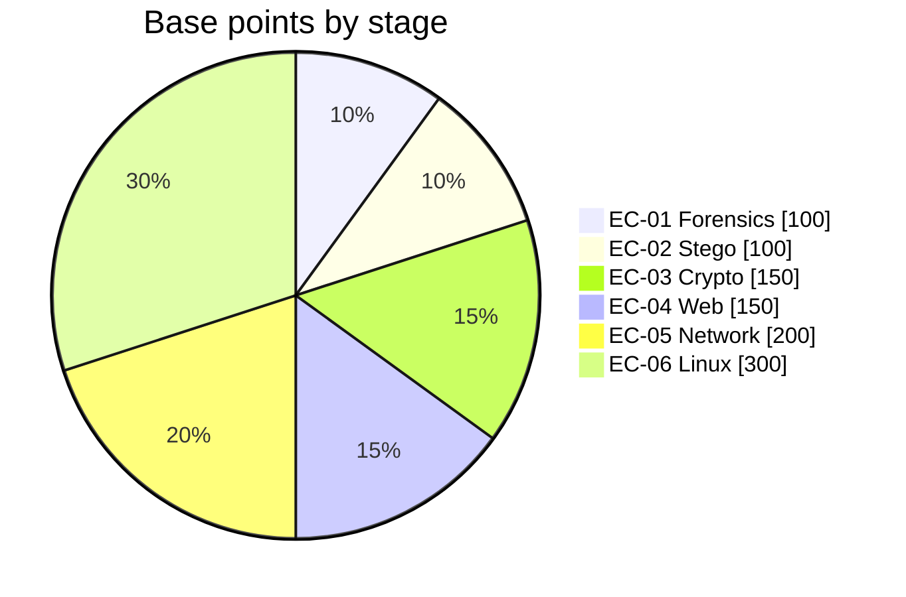
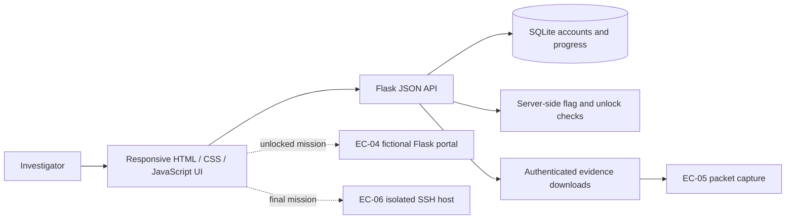
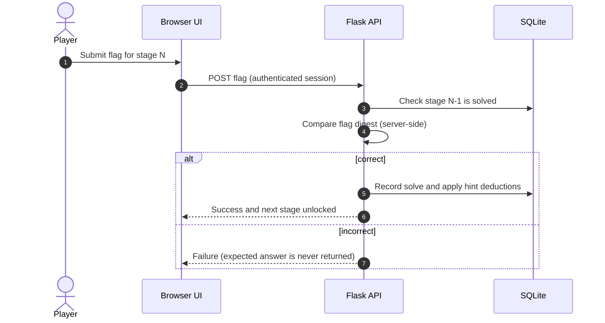
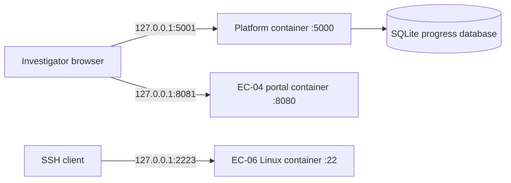
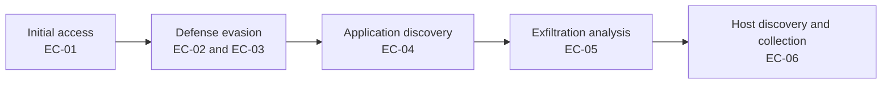

<div align="center">
  <h1>Ecorp-CTF-2026</h1>
  <p><strong>Operation E Corp Breach</strong> — a six-stage, story-driven cybersecurity capture-the-flag range.</p>
  <p><em>Follow one incident from a forged alert to a compromised Linux host.</em></p>
  
  <br><br>
  <a href="https://img.shields.io/badge/stages-6-5CFFC0?style=for-the-badge&amp;labelColor=06151b"></a>
  <a href="https://img.shields.io/badge/base_points-1%2C000-2EE6FF?style=for-the-badge&amp;labelColor=06151b"></a>
  <a href="https://img.shields.io/badge/Docker-Compose_v2-2496ED?style=for-the-badge&amp;logo=docker&amp;logoColor=white&amp;labelColor=06151b"></a>
  <a href="https://img.shields.io/badge/Python-3.11-3776AB?style=for-the-badge&amp;logo=python&amp;logoColor=white&amp;labelColor=06151b"></a>
  <a href="https://img.shields.io/badge/Flask-API-000000?style=for-the-badge&amp;logo=flask&amp;logoColor=white&amp;labelColor=06151b"></a>
  <a href="https://img.shields.io/badge/Exposure-Loopback_only-FF5F56?style=for-the-badge&amp;labelColor=06151b"></a>
  <p><a href="#-quick-start"><strong>Quick start</strong></a> · <a href="#-the-six-stage-investigation"><strong>Investigation</strong></a> · <a href="#-architecture"><strong>Architecture</strong></a> · <a href="#-mitre-attck-mapping"><strong>ATT&amp;CK map</strong></a> · <a href="#-running-a-session"><strong>Run a session</strong></a> · <a href="#-troubleshooting"><strong>Troubleshooting</strong></a></p>
</div>

---

> [!WARNING]
> **This is an intentionally vulnerable training lab.** It uses fictional data and loopback-only Docker port mappings. Keep it isolated. Never expose the targets to a public network and never use these techniques against systems you do not own or have written permission to test.

## 📑 Contents

- [Mission brief](#-mission-brief)
- [The six-stage investigation](#-the-six-stage-investigation)
- [What makes this range different](#-what-makes-this-range-different)
- [Architecture](#-architecture)
- [Quick start](#-quick-start)
- [Preflight health check](#-preflight-health-check)
- [Player field kit](#-player-field-kit)
- [MITRE ATT&CK mapping](#-mitre-attck-mapping)
- [Learning outcomes](#-learning-outcomes)
- [Scoring](#-scoring)
- [Running a session](#-running-a-session)
- [Organizer workflow](#-organizer-workflow)
- [Project layout](#-project-layout)
- [Design and accessibility](#-design-and-accessibility)
- [Safety model and spoiler policy](#-safety-model-and-spoiler-policy)
- [Troubleshooting](#-troubleshooting)
- [FAQ](#-faq)
- [Roadmap](#-roadmap)
- [Author and team contributions](#-author-and-team-contributions)

---

## 🎯 Mission brief

E Corp has reported a suspicious security alert, unexplained data movement, and a missing incident report. Investigators work through six linked exercises, moving from digital evidence to a fictional employee portal, then into a packet capture and finally a Linux host.

The range combines a responsive web platform with a Flask JSON API, SQLite-backed player progress, gated evidence downloads, and two deliberately vulnerable target services. It is built for guided demonstrations, classroom labs, and small-team CTF exercises.

```text
┌─────────────────────────────────────────────────────────────┐
│  CASE FILE   : EC-2026-BREACH                               │
│  CLIENT      : E Corp (fictional)                           │
│  STATUS      : OPEN                                         │
│  OBJECTIVE   : Reconstruct the attack and recover each flag │
│  RULES       : Evidence unlocks in order. Follow the trail. │
└─────────────────────────────────────────────────────────────┘
```

### Technology stack

| Layer | Technologies |
|---|---|
| Interface | Semantic HTML, responsive CSS, vanilla JavaScript, inline SVG |
| Platform API | Python 3.11, Flask, JSON endpoints |
| State | SQLite, server-managed sessions and progression |
| Range services | Docker Compose, separate Flask portal, isolated Linux/SSH target |
| Organizer workflow | Bash and Python build, synchronization, and verification scripts |

---

## 🕵️ The six-stage investigation

| Stage | Mission | Domain | Base points | Evidence / activity |
|---|---|---|---:|---|
| **EC-01** | The Forged Security Alert | Digital forensics | 100 | Inspect a suspicious email and its headers. |
| **EC-02** | The Password-Protected Image | Steganography | 100 | Examine image metadata and extract a hidden message. |
| **EC-03** | The Three-Layer Attacker Message | Cryptography | 150 | Reverse layered Base64, hexadecimal, and Vigenère encoding. |
| **EC-04** | The Compromised Employee Portal | Web security | 150 | Investigate exposed paths and intentionally broken access control. |
| **EC-05** | Tracing the Data Exfiltration | Networking | 200 | Analyze a PCAP and follow the suspicious HTTP conversation. |
| **EC-06** | The Final Breach Investigation | Linux / system security | 300 | Investigate a fictional SSH host, logs, hidden files, and a protected report. |

The path is **sequential**: submit the current stage's correct flag to unlock the next stage's evidence and tools. Challenge cards can be opened directly with `?challenge=ec01` through `?challenge=ec06`.

### Base-point distribution



Points rise with depth: the final host investigation is worth three times the opening stage.

---

## ✨ What makes this range different

| Feature | Why it matters |
|---|---|
| 📖 **One continuous story** | Each stage is a chapter of the same incident, so players practice investigating—not just solving isolated puzzles. |
| 🔐 **Server-owned progression** | Flag digests, unlocks, and scoring live in the API. Browser state cannot skip a stage. |
| 🚪 **Gated evidence** | Downloads are served through an access-controlled endpoint and open only when the stage is unlocked. |
| 🧪 **Real tooling, safe targets** | Players use header analysis, Wireshark, SSH, and other familiar tools against fictional systems. |
| 💡 **Progressive hints with a cost** | Hints become more specific as they are used, and the deduction is reflected in the score. |
| 🏆 **Live scoreboard** | Accepted solves feed a shared ranking for classroom or team play. |
| 🎖️ **Completion badge** | Finishing all six stages reveals a personalized achievement badge with SVG and PNG download options. |
| 🧰 **Organizer scripts** | Build, sync, and verify scripts help keep player-facing artifacts consistent. |
| ♿ **Accessible interface** | Reduced-motion support, visible keyboard focus, semantic links, and live status messages. |
| 📦 **Offline-friendly UI** | The platform interface needs no external fonts or JavaScript CDN. |

---

## 🏗️ Architecture



The browser presents the mission interface; the API owns progression and scoring decisions. EC-04 and EC-06 are separate services in the Compose range.

### Flag submission flow



### Network zones



| Component | Host address | Container service |
|---|---|---|
| CTF platform | `http://127.0.0.1:5001` | Flask on port `5000` |
| EC-04 portal | `http://127.0.0.1:8081` | Flask on port `8080` |
| EC-06 SSH target | `127.0.0.1:2223` | SSH on port `22` |

Compose binds host ports to `127.0.0.1`. The portal and SSH target are fictional lab services, not public internet services.

---

## 🚀 Quick start

### Requirements

- Docker Engine with the Docker Compose v2 plugin
- A shell capable of running the included Bash scripts

### Launch

From the project root:

```bash
bash sync_artefacts.sh
docker compose up -d --build
```

Open **http://127.0.0.1:5001**, create a callsign, and begin with **EC-01**. The portal and SSH target are reached later through the challenge clues and access cards.

### Operator commands

```bash
docker compose ps                         # inspect service status
docker compose logs -f platform           # follow platform logs
docker compose logs -f ec04 ec06          # inspect target logs
docker compose down                       # stop and remove the containers
```

> [!NOTE]
> If you intentionally change a host port, update the matching clue card, EC-03 generated message where applicable, integration notes, and verification checks together.

---

## 🩺 Preflight health check

Run this before a class or event to confirm the range is reachable. Every check below is local.

```bash
# 1. containers are up
docker compose ps

# 2. platform answers on the loopback port
curl -sI http://127.0.0.1:5001 | head -n 1

# 3. EC-04 portal answers
curl -sI http://127.0.0.1:8081 | head -n 1

# 4. EC-06 SSH port is listening
nc -zv 127.0.0.1 2223

# 5. confirm published ports are loopback-only
docker compose ps --format '{{.Name}}  {{.Ports}}'
```

Step 5 should show only `127.0.0.1:` bindings. If a service is published on `0.0.0.0`, stop the range and correct `docker-compose.yml` before continuing.

Run the organizer validation suite with:

```bash
bash verify.sh
```

---

## 🧰 Player field kit

Players may use their preferred tools; none are bundled in the range.

| Stage | Domain | Suggested tools |
|---|---|---|
| EC-01 | Forensics | A text editor or mail client that shows raw headers, `grep`, a local header viewer |
| EC-02 | Steganography | `exiftool`, `strings`, `file`, steganography extraction tools |
| EC-03 | Cryptography | [CyberChef](https://gchq.github.io/CyberChef/), Python, a Vigenère reference |
| EC-04 | Web security | Browser developer tools, `curl`, content discovery, an intercepting proxy |
| EC-05 | Networking | Wireshark or `tshark`, follow-stream, export-objects |
| EC-06 | Linux | `ssh`, `ls -la`, `find`, `grep`, `less`, log inspection |

---

## 🗺️ MITRE ATT&CK mapping

This is a **suggested learning alignment**, not a claim that the lab fully emulates each technique. Adjust technique IDs to match the final exercise and instructor guidance.

| Stage | Tactic / concept | Representative technique |
|---|---|---|
| EC-01 | Initial Access | [T1566](https://attack.mitre.org/techniques/T1566/) Phishing (spoofed sender scenario) |
| EC-02 | Defense Evasion | [T1027.003](https://attack.mitre.org/techniques/T1027/003/) Steganography |
| EC-03 | Defense Evasion | [T1027](https://attack.mitre.org/techniques/T1027/) Obfuscated Files or Information; [T1140](https://attack.mitre.org/techniques/T1140/) Deobfuscate/Decode Files or Information |
| EC-04 | Discovery / application testing | [T1595](https://attack.mitre.org/techniques/T1595/) Active Scanning (simulated against the local portal) |
| EC-05 | Exfiltration | [T1048.003](https://attack.mitre.org/techniques/T1048/003/) Exfiltration Over Unencrypted Non-C2 Protocol |
| EC-06 | Discovery / Collection | [T1083](https://attack.mitre.org/techniques/T1083/) File and Directory Discovery; [T1005](https://attack.mitre.org/techniques/T1005/) Data from Local System |



---

## 🎓 Learning outcomes

After completing the range, a player should be able to:

- [ ] Read raw email headers and identify signs of spoofing
- [ ] Inspect file metadata and recover hidden data from an image
- [ ] Recognize and reverse stacked encodings, and distinguish encoding from encryption
- [ ] Explain broken access control and why hidden paths are not security
- [ ] Follow a suspicious conversation through a packet capture and identify what was moved
- [ ] Navigate an unfamiliar Linux host: hidden files, logs, and permissions
- [ ] Write an incident timeline that links findings from all six stages

**Suggested debrief question:** *Which single control could have stopped the attack earliest, and at which stage?*

---

## 🏆 Scoring

| Rule | Behavior |
|---|---|
| Base points | Up to **1,000** across the six stages |
| Hints | Progressively stronger; each hint's cost is deducted from the score |
| Validation | Flag digests are checked server-side; responses never reveal the expected answer |
| Unlocks | Checked against recorded solves in SQLite, not browser state |
| Ranking | Accepted solves contribute to the shared scoreboard |
| Completion | Solving all six stages reveals the personalized badge |

---

## 🧑‍🏫 Running a session

The range can be used as a self-paced lab, a guided class demonstration, or a small-team exercise. The supplied Compose configuration is loopback-only, so each participant should use their own isolated instance unless an instructor has designed and secured a separate lab network.

| Format | Setup | Suggested pacing |
|---|---|---|
| **Guided demo** | Presenter runs the live range on one machine; audience follows the investigation | Short session; focus on selected stages |
| **Classroom lab** | One isolated instance per student | Stages 1–3 in one sitting, 4–6 in a second |
| **Team exercise** | One isolated instance per team, or instructor-managed isolated network | Teams compare findings and write a joint incident timeline |

**Facilitator tips**

- Run the [preflight check](#-preflight-health-check) before participants arrive.
- Keep the scoreboard visible during the session.
- Debrief with the [ATT&CK map](#-mitre-attck-mapping) after the exercise.
- Ask players to write the final incident timeline in their own words.

> [!IMPORTANT]
> For a shared event, use an isolated lab network that you control and review the port bindings first. Do not change the `127.0.0.1` bindings or expose the vulnerable targets to an untrusted network.

---

## 🛠️ Organizer workflow

The archive already contains player-facing evidence. These commands are for organizers rebuilding or editing it.

```bash
bash build.sh                 # rebuild/check EC-01 to EC-03 artifacts
bash sync_artefacts.sh        # copy player artifacts into the platform
bash verify.sh                # run the organizer validation suite
```

The EC-02 builder uses steganography tooling; the EC-03 generator uses Python's standard library. EC-05 traffic can be regenerated with `python3 stage05_network/generate_traffic.py` when its Scapy dependency is available. Re-run synchronization after changing a source artifact so the platform and EC-04 portal receive the same player-facing file.

### Organizer checklist

- [ ] `bash build.sh` completes without errors
- [ ] `bash sync_artefacts.sh` runs after every evidence change
- [ ] `bash verify.sh` passes
- [ ] `docker compose up -d --build` starts all three services
- [ ] Preflight shows only `127.0.0.1` bindings
- [ ] `stage0*/private/`, `platform/seed_flags.py`, and `platform/secrets/` are excluded from a player-only distribution
- [ ] A test player completes EC-01 to EC-06 end to end

For the platform service, see [`platform/README.md`](platform/README.md). Additional deployment and stage notes are in [`docs/`](docs/) and [`platform/INTEGRATION_NOTES.md`](platform/INTEGRATION_NOTES.md).

---

## 🗂️ Project layout

```text
Ecorp-CTF-2026/
├── README.md                         # project guide and operator quickstart
├── docker-compose.yml                # loopback-only range topology
├── build.sh                          # EC-01–EC-03 organizer build
├── sync_artefacts.sh                 # synchronize player evidence
├── verify.sh                         # organizer validation checks
├── docs/
│   ├── assets/ecorp-ctf-2026-banner.svg
│   ├── CTFD_SETUP.md
│   └── STAGES_1-3_README.md
├── platform/
│   ├── app.py                        # Flask API, auth, progression, scoring
│   ├── index.html                    # responsive mission interface
│   ├── seed_flags.py                 # organizer flag-hash seeder
│   ├── artefacts/                    # platform-served evidence
│   └── secrets/                      # private server-side material
├── stage01_forensics/                # email evidence
├── stage02_stego/                    # image and hidden payload
├── stage03_crypto/                   # layered message generator
├── stage04_web/                      # fictional employee portal
├── stage05_network/                  # PCAP generator and capture
└── stage06_linux/                    # isolated Linux/SSH target
```

Each stage folder contains maintainer sources and, where applicable, separate `public/` and `private/` material. Keep private files out of player-facing downloads.

---

## 🎨 Design and accessibility

The platform uses a dark operations-console visual language with mint/cyan accents, inline SVG iconography, responsive layouts, and restrained interaction feedback.

| Area | Behavior |
|---|---|
| Motion | Ambient background drift, hero illustration, hover states, and short modal/toast transitions—without a continuous JavaScript animation loop |
| Reduced motion | Honors `prefers-reduced-motion` in both the platform and README banner |
| Keyboard | Visible focus states on interactive elements |
| Semantics | Real links for challenge navigation and live regions for key status messages |
| Dependencies | No external fonts or JavaScript CDNs required by the platform UI |

---

## 🛡️ Safety model and spoiler policy

### Safety model

| Control | Detail |
|---|---|
| Training scope | EC-04 intentionally demonstrates unsafe discovery and access-control behavior; EC-06 is a deliberately configured practice host |
| Loopback exposure | Compose publishes services on `127.0.0.1`. Do not change this to `0.0.0.0` or forward it to an untrusted network |
| Organizer material | `stage0*/private/`, `platform/seed_flags.py`, `platform/secrets/`, and some design/deployment documents contain answer or operator information |
| Synthetic data | E Corp, people, credentials, incidents, and artifacts are fictional |
| Production status | This is an educational CTF range, not a hardened production service |

### Spoiler policy

This README intentionally contains **no flags, credentials, or solution steps**. Keep walkthroughs in a separate organizer-only document and out of player-facing distributions. Share public writeups only after an event ends.

---

## 🔧 Troubleshooting

<details>
<summary><strong>The platform page loads, but evidence or solves are unavailable</strong></summary>

Check the platform container with `docker compose ps`, then inspect `docker compose logs -f platform`. Confirm that `bash sync_artefacts.sh` completed before starting the range.

</details>

<details>
<summary><strong>The EC-04 portal or EC-06 SSH connection does not respond</strong></summary>

Check `ec04` and `ec06` with `docker compose ps` and review their logs. Confirm that host ports `8081` and `2223` are free. The container ports remain `8080` and `22` respectively.

</details>

<details>
<summary><strong>The EC-03 clue points to the wrong portal port</strong></summary>

The decoded address comes from `stage03_crypto/private/plaintext.txt`. Regenerate the public message with `python3 stage03_crypto/generate_message.py`, then run `bash sync_artefacts.sh` and `bash verify.sh`.

</details>

<details>
<summary><strong>A host port is already in use</strong></summary>

Find the process using it, stop that process, or change the host-side port in `docker-compose.yml`. If you change it, update the matching clue card, the EC-03 message where relevant, integration notes, and verification checks together.

</details>

<details>
<summary><strong>I want to reset player progress</strong></summary>

The supplied Compose file does not mount a persistent database volume. Run `docker compose down`, then `docker compose up -d --build`; the recreated platform container starts with a fresh SQLite database. Back up the database first if you need to retain scores.

</details>

<details>
<summary><strong>The banner image does not show on GitHub</strong></summary>

Confirm that `docs/assets/ecorp-ctf-2026-banner.svg` exists in the repository with the same letter case and is committed. The README uses a repository-relative image path.

</details>

---

## ❓ FAQ

**Do I need internet access to play?**  
Once the Docker images are available, the platform itself has no external font or CDN dependency. The first image build may need access to the container registry.

**Can I run it on a shared server?**  
Only in an isolated environment you control. The targets are intentionally vulnerable; the default Compose bindings are loopback-only.

**Can players skip ahead?**  
No. Unlocks are enforced server-side against recorded solves.

**Where do the answers live?**  
In organizer-only files such as `private/`, `seed_flags.py`, and `secrets/`. Keep those files out of player distributions.

**Can I add a seventh stage?**  
Yes. Follow the existing stage-folder pattern, seed its flag digest, register its evidence and prerequisite in the platform, then update the synchronization and verification scripts.

---

## 🧭 Roadmap

Ideas for future versions (**not yet implemented**):

- [ ] Optional timed event mode with a pauseable scoreboard
- [ ] Per-team accounts and team scoring
- [ ] Organizer dashboard for live solve and hint statistics
- [ ] Printable incident-report template for the final debrief
- [ ] Bonus side quests that do not affect the main 1,000 points

---

## 👤 Author and team contributions

**Chanuka Nuwan** (`chnk0x`) — cybersecurity undergraduate at SLIIT; **Member 01, CTF Platform & Architecture**.

[](https://github.com/chnk0x)  
[](https://www.linkedin.com/in/chanuka-nuwan-1a07b8393)

### Member contributions

| Member | Contribution |
|---|---|
| **Member 01 — Chanuka Nuwan** ([GitHub](https://github.com/chnk0x)) | CTF Platform & Architecture: platform interface and API, deployment topology, server-side flag validation and stage progression, isolation and reset design. |
| **Member 02 — Danidu** ([GitHub](https://github.com/Danidu-S)) | Challenge Design A — EC-01 to EC-03: digital forensics, steganography, and cryptography stages; evidence, build logic, and intended solve paths. |
| **Member 03 — Praween** ([GitHub](https://github.com/IT24103798)) | Challenge Design B — EC-04 to EC-06: web portal, network capture, and Linux/SSH stages; target services and stage evidence. |
| **Member 04 — Christina** ([GitHub](https://github.com/ChristinaPerera)) | Integration, Testing & Documentation: end-to-end stage integration, validation and recovery checks, test evidence, and project documentation. |

*The contribution rows follow the team's assigned project roles. Add or adjust teammate names only after confirming them with the team.*

Feedback, issues, and stage ideas are welcome.

---

<div align="center">
  <sub>OPERATION E CORP · FOLLOW THE EVIDENCE · VERIFY EVERY FLAG · CLOSE THE INCIDENT</sub>
</div>
