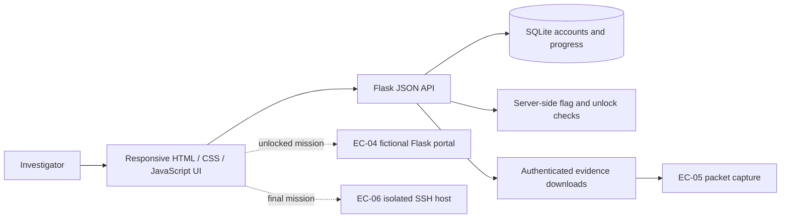

<div align="center">
  
  <h1>Ecorp-CTF-2026</h1>
  <p><strong>Operation E Corp Breach</strong> · A six-stage, story-driven cybersecurity capture-the-flag range</p>
  <p><code>6 CONNECTED MISSIONS</code> &nbsp; <code>6 SECURITY DOMAINS</code> &nbsp; <code>1,000 BASE POINTS</code></p>
</div>

> Follow the incident from a forged alert to a compromised Linux host. Each recovered clue opens the next lead; each accepted flag advances the investigation.

**This is an intentionally vulnerable training lab.** It uses fictional data and loopback-only Docker port mappings. Keep it isolated—do not expose the targets to a public network or use them against real systems.

## Contents

- [Mission brief](#mission-brief)
- [The six-stage investigation](#the-six-stage-investigation)
- [Platform capabilities](#platform-capabilities)
- [How the pieces connect](#how-the-pieces-connect)
- [Launch the isolated range](#launch-the-isolated-range)
- [Build and verify challenge evidence](#build-and-verify-challenge-evidence)
- [Project layout](#project-layout)
- [Motion, accessibility, and visual design](#motion-accessibility-and-visual-design)
- [Security and handling notes](#security-and-handling-notes)
- [Troubleshooting](#troubleshooting)

## Mission brief

E Corp has reported a suspicious security alert, unexplained data movement, and a missing incident report. Investigators work through six linked exercises, moving from digital evidence to a live fictional portal, then into a packet capture and Linux host.

The range combines a responsive web platform with a Flask JSON API, SQLite-backed player progress, gated evidence downloads, and two deliberately vulnerable target services. It is designed for guided demonstrations, classroom labs, and small-team CTF exercises.

### Technology stack

| Layer | Technologies |
|---|---|
| Interface | Semantic HTML, responsive CSS, vanilla JavaScript, inline SVG |
| Platform API | Python 3.11, Flask, JSON endpoints |
| State | SQLite, server-managed sessions and progression |
| Range services | Docker Compose, separate Flask portal, isolated Linux/SSH target |
| Organizer workflow | Bash and Python build, synchronization, and verification scripts |

## The six-stage investigation

| Stage | Mission | Domain | Base points | Evidence / activity |
|---|---|---|---:|---|
| **EC-01** | The Forged Security Alert | Digital forensics | 100 | Inspect a suspicious email and its headers. |
| **EC-02** | The Password-Protected Image | Steganography | 100 | Examine image metadata and extract a hidden message. |
| **EC-03** | The Three-Layer Attacker Message | Cryptography | 150 | Reverse layered Base64, hexadecimal, and Vigenère encoding. |
| **EC-04** | The Compromised Employee Portal | Web security | 150 | Investigate exposed paths and intentionally broken access control. |
| **EC-05** | Tracing the Data Exfiltration | Networking | 200 | Analyze a PCAP and follow the suspicious HTTP conversation. |
| **EC-06** | The Final Breach Investigation | Linux / system security | 300 | Investigate a fictional SSH host, logs, hidden files, and a protected report. |

The path is sequential: submit the current stage’s correct flag to unlock the next stage’s evidence and tools. The platform awards up to **1,000 base points** before hint deductions. The challenge cards and mission pages can be addressed individually with `?challenge=ec01` through `?challenge=ec06`.

## Platform capabilities

- **Mission dossiers:** each stage has its own story, objectives, evidence area, hint panel, status, and flag form.
- **Account and progress tracking:** player callsigns, solves, points, and hint costs are managed through the Flask API and SQLite.
- **Server-side validation:** flag digests are checked on the server; responses report success or failure without returning the expected answer.
- **Ordered unlocks:** requirements are checked against recorded solves, not browser-side state.
- **Gated evidence:** the platform serves stage downloads through an access-controlled endpoint.
- **Scoring and hints:** hints reveal progressively stronger clues, with the cost reflected in the player's score.
- **Scoreboard:** accepted solves contribute to a shared ranking.
- **Completion award:** solving all six stages reveals a personalized cyber-themed achievement badge, with SVG and PNG download options.

## How the pieces connect



The browser presents the mission interface; the API owns the progression and scoring decisions. EC-04 and EC-06 are separate services in the Compose range. The key host ports are:

| Component | Host address | Container service |
|---|---|---|
| CTF platform | `http://127.0.0.1:5001` | Flask on port `5000` |
| EC-04 portal | `http://127.0.0.1:8081` | Flask on port `8080` |
| EC-06 SSH target | `127.0.0.1:2223` | SSH on port `22` |

The Compose file binds host ports to `127.0.0.1`; the portal and SSH target are part of the fictional lab, not public internet services.

## Launch the isolated range

### Requirements

- Docker Engine with the Docker Compose v2 plugin
- A shell capable of running the included Bash scripts

### Start

From the project root:

```bash
bash sync_artefacts.sh
docker compose up -d --build
```

Open **http://127.0.0.1:5001**, create a callsign, and begin with EC-01. The portal and SSH target are reached later through the challenge clues and access cards.

Useful operator commands:

```bash
docker compose ps                         # inspect service status
docker compose logs -f platform           # follow platform logs
docker compose logs -f ec04 ec06          # inspect target logs
docker compose down                       # stop and remove the containers
```

The services use fictional accounts, flags, and evidence. Keep the loopback-only port mappings. If you intentionally change a host port, update the corresponding clue card, EC-03 generated message where applicable, integration notes, and verification checks together.

## Build and verify challenge evidence

The supplied archive already contains player-facing evidence. These commands are for organizers who are rebuilding or editing it.

```bash
bash build.sh                 # rebuild/check EC-01 to EC-03 artifacts
bash sync_artefacts.sh        # copy player artifacts into the platform
bash verify.sh                # run the organizer validation suite
```

The EC-02 builder uses steganography tooling; the EC-03 generator uses only Python's standard library. EC-05 traffic can be regenerated with `python3 stage05_network/generate_traffic.py` when its Scapy dependency is available. Re-run synchronization after changing a source artifact so the platform and EC-04 portal receive the same player-facing file.

For the platform alone, see [`platform/README.md`](platform/README.md). Additional deployment and stage notes are in [`docs/`](docs/) and [`platform/INTEGRATION_NOTES.md`](platform/INTEGRATION_NOTES.md).

## Project layout

```text
Ecorp-CTF-2026/
├── README.md                         # project guide and operator quickstart
├── docker-compose.yml                # loopback-only range topology
├── build.sh                          # EC-01–EC-03 organizer build
├── sync_artefacts.sh                 # publish/synchronize player evidence
├── verify.sh                         # organizer validation checks
├── docs/
│   ├── assets/ecorp-ctf-2026-banner.svg
│   ├── CTFD_SETUP.md
│   └── STAGES_1-3_README.md
├── platform/
│   ├── app.py                        # Flask API, auth, progression, scoring
│   ├── index.html                    # responsive mission interface
│   ├── seed_flags.py                 # organizer flag-hash seeder
│   ├── artefacts/                    # platform-served evidence
│   └── secrets/                      # private server-side material
├── stage01_forensics/                # email evidence
├── stage02_stego/                    # image and hidden payload
├── stage03_crypto/                   # layered message generator
├── stage04_web/                      # fictional employee portal
├── stage05_network/                  # PCAP generator and capture
└── stage06_linux/                    # isolated Linux/SSH target
```

Each stage folder contains maintainer sources and, where applicable, separate `public/` and `private/` material. Keep private files out of player-facing downloads.

## Motion, accessibility, and visual design

The platform uses a dark operations-console visual language with mint/cyan accents, inline SVG iconography, responsive layouts, and restrained interaction feedback. Ambient background drift, the hero illustration, card hover states, and short modal/toast transitions add motion without relying on a continuous JavaScript animation loop. The interface honors `prefers-reduced-motion`, provides visible keyboard focus, uses semantic links for challenge navigation, and includes live status messaging for key actions.

The README banner is a small self-contained SVG with a slow scan accent; it also stops its decorative motion when reduced motion is requested. No external font or JavaScript CDN is required for the platform UI.

## Security and handling notes

- **Training scope:** EC-04 intentionally demonstrates unsafe discovery and access-control behavior; EC-06 is a deliberately configured practice host. Run the range only in an isolated environment.
- **Loopback exposure:** Compose publishes the host services on `127.0.0.1`. Do not change these bindings to `0.0.0.0` or forward them to an untrusted network.
- **Organizer material:** `stage0*/private/`, `platform/seed_flags.py`, `platform/secrets/`, and some design/deployment documents contain answer or operator information. Do not include them in a player-only distribution.
- **Synthetic data:** E Corp, people, credentials, incidents, and artifacts are fictional and intended only for this exercise.
- **No production claim:** this is an educational CTF range, not a hardened production service.

## Troubleshooting

<details>
<summary><strong>The platform page loads, but evidence or solves are unavailable</strong></summary>

Check that the platform container is healthy with `docker compose ps`, then inspect `docker compose logs -f platform`. Confirm the evidence sync completed before starting the range.

</details>

<details>
<summary><strong>The EC-04 portal or EC-06 SSH connection does not respond</strong></summary>

Check the `ec04` and `ec06` services with `docker compose ps` and review their logs. Confirm that the host ports `8081` and `2223` are not already in use. The container ports remain `8080` and `22` respectively.

</details>

<details>
<summary><strong>The EC-03 clue points to the wrong portal port</strong></summary>

The decoded address comes from `stage03_crypto/private/plaintext.txt`. Regenerate the public message with `python3 stage03_crypto/generate_message.py`, then run `bash sync_artefacts.sh` and `bash verify.sh`.

</details>

---

<div align="center">
  <sub>OPERATION E CORP · FOLLOW THE EVIDENCE · VERIFY EVERY FLAG · CLOSE THE INCIDENT</sub>
</div>
